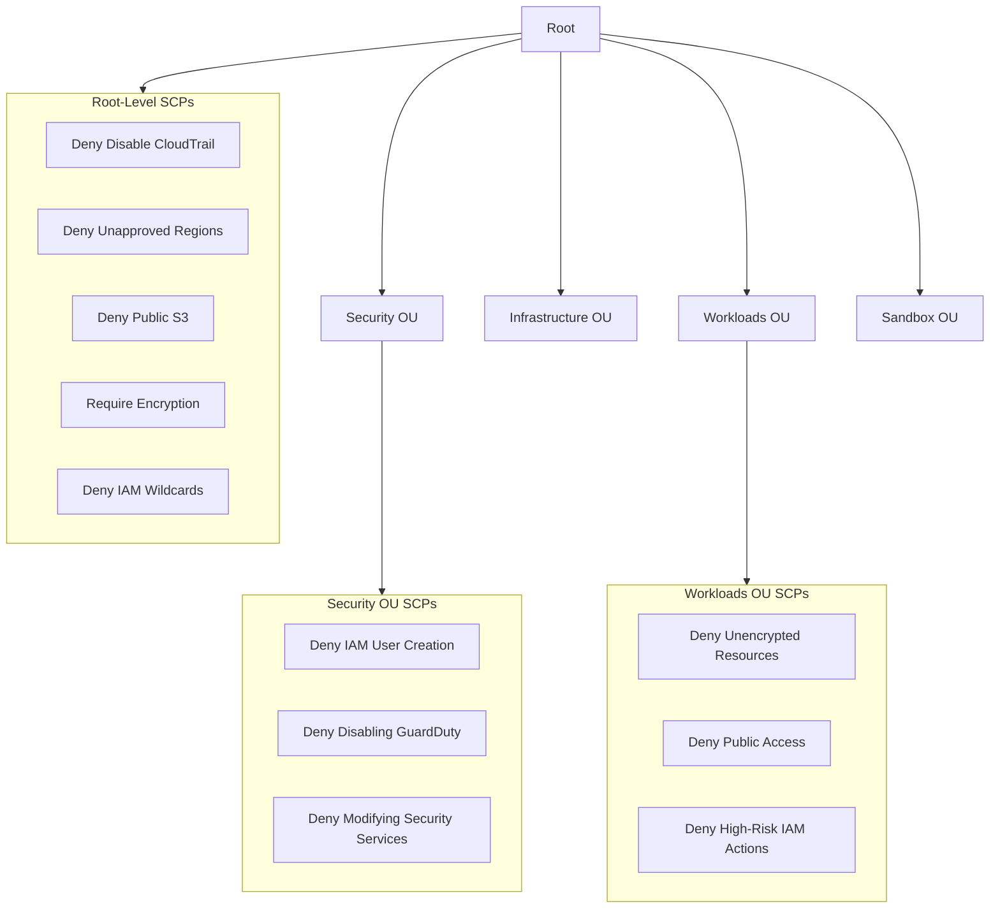
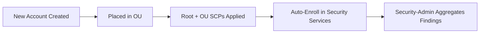

# AWS Organization Management Architecture

## 1. Purpose

This document defines the **governance plane** of the Healthcare Event Stream Platform (HESP) Landing Zone.  
It describes how the AWS Organization is structured, how accounts are grouped into Organizational Units (OUs), how Service Control Policies (SCPs) are applied, and how delegated administrator accounts manage security services across the organization.

This layer is separate from the **application landing zone** (VPC, ECS, ALB, data plane).  
The org‑management layer governs **identity, security, compliance, and account lifecycle** for the entire AWS Organization.

---

## 2. AWS Organization Overview

The AWS Organization consists of:

- A **Management Account** (formerly “Master Account”)  
- Multiple **Organizational Units (OUs)**  
- Member accounts grouped by function  
- Delegated administrator accounts for security services  
- Global and OU‑specific SCPs  
- Organization‑wide security services (CloudTrail, Config, GuardDuty, Security Hub, Inspector)

### Organization Structure Diagram

```mermaid
flowchart TD
    MGMT[Management Account<br/>(Org Root Owner)]
    
    subgraph ROOT[Root]
        direction TB

        subgraph SEC_OU[Security OU]
            SEC_ADMIN[Security-Admin Account<br/>(Delegated Admin)]
        end

        subgraph INFRA_OU[Infrastructure OU]
            LOG[Log Archive Account]
            SHARED[Shared Services Account]
        end

        subgraph WORKLOAD_OU[Workloads OU]
            DEV[Dev Account]
            QA[QA Account]
            PROD[Prod Account]
        end

        subgraph SANDBOX_OU[Sandbox OU]
            SBX[Developer Sandbox Accounts]
        end
    end

    MGMT --> ROOT
```

---

## 3. Management Account Responsibilities

The **Management Account** owns and governs the entire AWS Organization.  
It is responsible for:

- Creating OUs  
- Creating and inviting accounts  
- Attaching SCPs  
- Enabling org‑level services:
  - AWS Config (org)
  - CloudTrail (org)
  - GuardDuty (org)
  - Security Hub (org)
  - Inspector (org)
- Delegating admin rights to the Security‑Admin account  
- Enforcing global guardrails

The management account **does not run workloads** and **cannot be restricted by SCPs**.

---

## 4. Delegated Administrator Architecture

The **Security‑Admin Account** is the delegated admin for all organization‑wide security services.

### Delegated Admin Diagram

```mermaid
flowchart LR
    MGMT[Management Account]
    SEC[Security-Admin Account<br/>(Delegated Admin)]

    GD[GuardDuty]
    HUB[Security Hub]
    INS[Inspector]
    CFG[AWS Config Aggregator]

    MGMT -->|Enable Org-Level Service| GD
    MGMT --> HUB
    MGMT --> INS
    MGMT --> CFG

    GD -->|Delegated Admin| SEC
    HUB --> SEC
    INS --> SEC
    CFG --> SEC
```

### What Delegated Admin Enables

The Security‑Admin account can:

- View GuardDuty findings from all accounts  
- View Security Hub findings from all accounts  
- Run Inspector scans across the org  
- Aggregate AWS Config compliance across all accounts  
- Auto‑enroll new accounts into all security services  

This centralizes security operations without using the management account.

---

## 5. Organizational Units (OUs)

### OU Structure

| OU Name          | Purpose |
|------------------|---------|
| **Security OU**  | Delegated admin + audit/logging accounts |
| **Infrastructure OU** | Shared networking, logging, platform services |
| **Workloads OU** | Application accounts (dev, qa, prod) |
| **Sandbox OU**   | Developer experimentation accounts |

Each OU inherits SCPs from the Root and may have additional OU‑specific guardrails.

---

## 6. Service Control Policies (SCPs)

SCPs enforce **organization‑wide guardrails**.  
They do not grant permissions — they **limit** what accounts *can* do.

### SCP Categories

#### **Root-Level Global Guardrails**
Applied once at the Root:

- Deny disabling CloudTrail  
- Deny leaving the organization  
- Deny unapproved AWS regions  
- Deny public S3 buckets  
- Require encryption (S3, EBS, RDS, etc.)  
- Deny IAM wildcard permissions  

#### **OU-Specific Guardrails**

**Security OU**
- Deny IAM user creation  
- Deny disabling GuardDuty / Security Hub  
- Deny modifying security tooling  

**Workloads OU**
- Deny unencrypted resources  
- Deny public access  
- Deny high‑risk IAM actions  

**Sandbox OU**
- Minimal guardrails  
- Prevent privilege escalation  

---

## 7. SCP Attachment Diagram

This diagram shows **where SCPs attach** and how inheritance works.



### Key Rule

> **SCPs attached at the Root automatically apply to all OUs and accounts.  
> Do NOT attach the same SCP to both Root and OUs.**

---

## 8. Account Creation & Auto‑Enrollment Flow

When a new account is created:

1. It is placed into an OU  
2. It inherits Root‑level SCPs  
3. It inherits OU‑specific SCPs  
4. It auto‑enrolls into:
   - GuardDuty  
   - Security Hub  
   - Inspector  
   - AWS Config  
5. Findings and compliance data flow to the Security‑Admin account  
6. CloudTrail and Config deliver logs to the Log Archive account  

### Account Lifecycle Diagram



---

## 9. Summary

The org‑management layer provides:

- A secure, governed AWS Organization  
- Clear separation of governance vs workloads  
- Centralized security operations via delegated admin  
- Strong global guardrails via Root‑level SCPs  
- OU‑specific restrictions for different environments  
- Automatic enrollment into security services  
- A consistent, compliant foundation for all HESP workloads  

This document should be maintained alongside the Terraform in `org-management/` to ensure the governance model remains clear and auditable.

